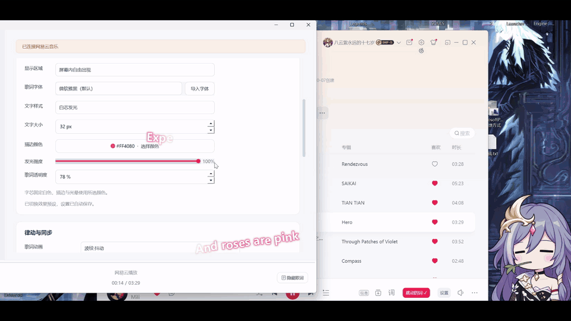
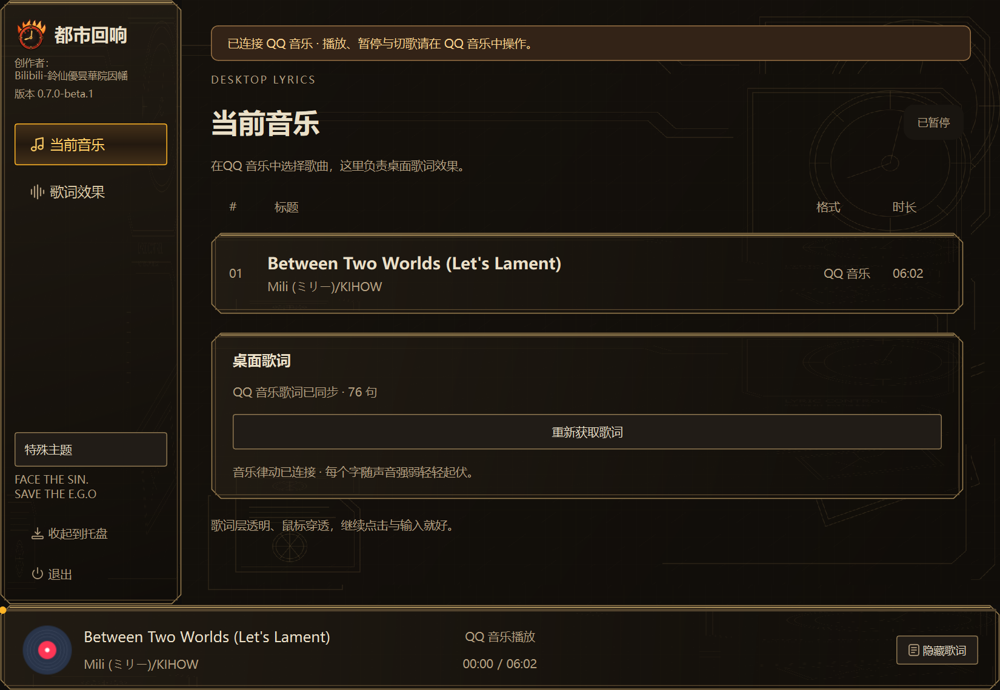
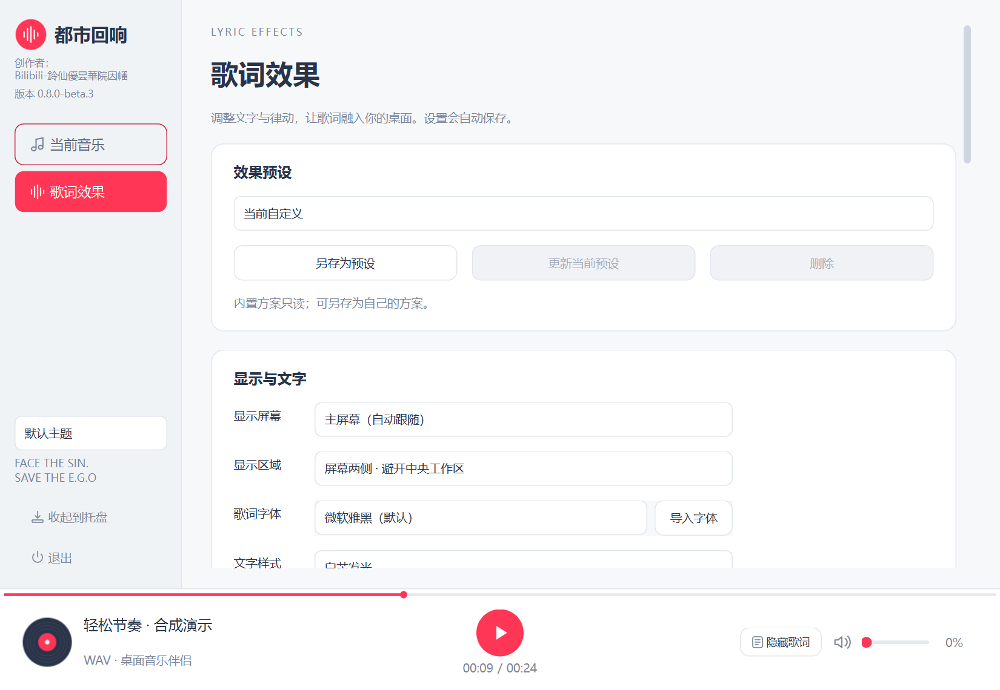

# 都市回响

酷狗音乐 **Mac 源码测试版**见 [KUGOU-MACOS.md](KUGOU-MACOS.md)：安装时自动识别芯片，
复用当前歌词效果；尚未生成 Mac 成品或完成真机播放验收。下方旧网易云 Mac 下载不适用于酷狗。

让歌词在桌面随音乐跳动。Windows 支持网易云、QQ 音乐与酷狗音乐联动、逐字动画、字体效果、预设及主题切换。



桌面实机录屏，约 18 秒，循环播放（GIF 无声）。

**[下载 Windows x64 试用版](https://github.com/Celine258/idea-from-limbus-company-dancing-lyrics/releases/tag/v0.8.0-beta.3)** · [问题反馈](https://github.com/Celine258/idea-from-limbus-company-dancing-lyrics/issues)

Windows 请按播放器选择独立压缩包：

| 使用的播放器 | 下载 | 使用入口 |
| --- | --- | --- |
| 酷狗音乐 | [下载酷狗音乐版 ZIP](https://github.com/Celine258/idea-from-limbus-company-dancing-lyrics/releases/download/v0.8.0-beta.3-kugou.1/dancing-lyrics-0.8.0-beta.3-kugou.1-windows-x64.zip) | 开启酷狗桌面歌词，双击“启动酷狗联动.bat” |
| QQ 音乐 | [下载 QQ 音乐版 ZIP](https://github.com/Celine258/idea-from-limbus-company-dancing-lyrics/releases/download/v0.8.0-beta.3/dancing-lyrics-0.8.0-beta.3-qqmusic-windows-x64.zip) | 打开 QQ 音乐，双击“启动QQ音乐联动.bat” |
| 网易云音乐 | [下载网易云音乐版 ZIP](https://github.com/Celine258/idea-from-limbus-company-dancing-lyrics/releases/download/v0.8.0-beta.3/dancing-lyrics-0.8.0-beta.3-netease-windows-x64.zip) | 首次安装联动，之后从网易云播放栏打开 |

各播放器使用不同解压目录，入口与说明各自独立，均内置运行环境。QQ／网易云旧通用包升级时，先退出歌词程序，将旧 `.state` 整个复制到对应新目录；网易云版还需退出网易云并重新安装联动以更新路径。同一时间只运行一个歌词实例。

**酷狗音乐修复版**：完整解压 → 酷狗播放歌曲并开启桌面歌词 → 双击“启动酷狗联动.bat”。显示“原生歌词通道”或“系统媒体接口”后可最小化酷狗。本版修复 `Mili`／`Mili（ミリー）` 等别名导致的后台断连；未知结构仍会回退到需展开窗口的界面兼容模式，不承诺所有客户端后台可用。可选安装个人快捷方式及开启“随酷狗启动”；升级保留 `%LOCALAPPDATA%\DancingLyrics-Kugou\.state`，移动后需重新设置自动启动。详见 [酷狗安装与后台使用说明](KUGOU.md)。基于 [CAR0TT0 的 PR #4](https://github.com/Celine258/idea-from-limbus-company-dancing-lyrics/pull/4) 继续修复，保留作者贡献。本轮网易云、QQ 与酷狗分别更新独立下载包。


**[下载 Mac 实验版](https://github.com/Celine258/idea-from-limbus-company-dancing-lyrics/releases/tag/v0.6.0-beta.2-macos.1)**（内置 Python）

| Mac 芯片 | 压缩包 |
| --- | --- |
| Apple Silicon：M 系列 | [下载 arm64 ZIP](https://github.com/Celine258/idea-from-limbus-company-dancing-lyrics/releases/download/v0.6.0-beta.2-macos.1/city-echoes-0.6.0-beta.2-macos.1-arm64.zip) |
| Intel | [下载 x86_64 ZIP](https://github.com/Celine258/idea-from-limbus-company-dancing-lyrics/releases/download/v0.6.0-beta.2-macos.1/city-echoes-0.6.0-beta.2-macos.1-x86_64.zip) |

Mac：解压后将 `都市回响.app` 拖到“应用程序”，首次运行包内“安装播放读取工具.command”，然后打开应用。
读取播放信息需单独安装 `nowplaying-cli`（需要 Homebrew），不需要安装 Python。尚未 Apple 公证；首次打开及详细步骤见 [Mac 安装说明](MACOS.md)。
下列 BAT 安装步骤仅用于 Windows。

[观看 30 秒无音乐演示](https://github.com/Celine258/idea-from-limbus-company-dancing-lyrics/releases/download/v0.6.0-beta.2/dancing-lyrics-demo-30s.mp4)

**使用 QQ 音乐**（新版支持自动启动）：

1. 下载 **QQ 音乐版 ZIP**，完整解压到长期保留且可写的目录；保留 EXE 旁的整个 `_internal` 文件夹。
2. 打开 QQ 音乐播放歌曲，首次双击 **启动QQ音乐联动.bat**。确认“已连接 QQ 音乐”和“歌词已同步”；暂停时动画也会冻结。
3. 想以后自动联动，在 **当前音乐 → QQ 音乐自动联动 → 随 QQ 音乐启动** 打勾。默认关闭；开启后立即监听，并在 Windows 登录时继续监听，之后打开 QQ 音乐就会自动启动歌词效果。

自动启动时设置面板收在**系统托盘**，右键托盘图标可打开设置；再次双击 BAT 会恢复已有窗口，不重复创建 QQ 歌词实例。关闭开关可取消，监听约 2 秒内退出，当前歌词继续运行。手动退出歌词后，本次 QQ 会话不会反复拉起，重开 QQ 音乐后恢复自动启动。

**QQ 更新到 22.75 后**，如果显示“等待 QQ 音乐播放歌曲”，先在 QQ 设置中确认开启“系统媒体控制”，再播放一首歌曲。客户端刚打开时可能只提供 `Opened` 状态、零时长和零进度，此时程序会等待真实时间轴，避免错误显示旧歌词。

22.75 实测暂停后可能再校正一次系统时间轴，校正稳定后歌词保持冻结；若在暂停时主动拖动进度，歌词仍按客户端位置更新。

**更新或删除前**先关闭开关，等待约 2 秒，再从托盘退出歌词程序；更新保留 `.state`。移动目录或换新目录后，从新目录手动启动并重新开启开关。无需管理员权限或 BetterNCM；QQ 播放栏不增加按钮。系统可能延迟或禁用登录启动，遇到这种情况先手动打开 BAT，检查 Windows“启动应用”。详见 [QQ 音乐使用说明](QQMUSIC.md)。


> [!IMPORTANT]
> **QQ 音乐取词：新版已接入本地缓存优先、现有官方接口兜底。**
>
> **已缓存的歌曲**：自动寻找 QQ 已加载的歌词缓存；严格匹配歌名、歌手、专辑与时长后直接读取，支持缓存中的真实字词时间和中文译文。找不到目录时，可在“当前音乐”点击“选择歌词缓存目录”，选择 `QQMusicLyricNew` 或其上一级目录。
>
> **首次播放或没有缓存的歌曲**：仍会联网搜索歌曲再获取歌词，同时在切歌后的 20 秒内检查迟到缓存。QQ 尚未加载并写盘、缓存格式未知或匹配不可靠时可能较慢，**不能保证所有歌曲都和网易云一样快**。
>
> 本机 14 首真实缓存均已解析成功。Python 暖缓存读取、解码与解析的 P95 不超过约 **22ms**，这**不是切歌到歌词显示的总延迟**；首次写盘等待、非零外层偏移、其他 QQ 版本与第二台电脑仍待验证。格式不可靠时自动回退，详见 [QQ 歌词缓存研究](docs/QQ歌词缓存研究.md) 与 [QQ 音乐使用说明](QQMUSIC.md)。

**使用网易云音乐**：

1. 下载 `dancing-lyrics-0.8.0-beta.3-netease-windows-x64.zip`，完整解压到长期保留且可写的目录。
2. 完全退出网易云（包括托盘），双击 **安装网易云联动.bat**，在窗口点击安装。
3. 重开网易云，点击播放栏的“都市回响”；右键或点击“设置”调整效果。
无需 Python 或 Git。请下载 ZIP 成品，页面的 Source code 是源码。同一个 ZIP 自动识别 **网易云 3.1.40.205461／3.1.41.205529 x64**。已验证 Windows 11 x64、BetterNCM 1.3.4；尚未在第二台干净电脑完成试装。

**客户端更新后的兼容检测（v0.7.0-beta.6 起）：** 安装窗口自动读取完整版本，显示“已验证兼容”“未验证”或“已知不兼容”。打开安装窗口会在后台尝试更新在线兼容列表，也可点击“联网刷新兼容列表”；网络失败沿用内置列表或有效缓存。维护者确认新版本可用后，更新列表即可允许正常安装，无需仅为解除版本限制重新下载。

未验证的版本可以勾选 **“实验性安装（未验证版本）”**，每次安装单独确认。**不能保证未来所有版本兼容**；此入口仅跳过版本白名单，仍检查 x64、框架 SHA-256、文件冲突和客户端已退出。已知不兼容版本禁止安装。连接后按实际接口选择客户端歌词状态或本机缓存，当前音乐页显示检测结果；播放接口变化时停止歌词并提示，不操作网易云播放。

实验安装导致网易云打不开时，完全退出网易云，运行 **恢复网易云联动.bat**，选择 **恢复上次安装**。它恢复本目录最近一次安装前的插件和连接配置，保留个人设置、字体和预设；仅移除该次新建且未变化的框架。原有共用框架保留，文件被修改或新增共用插件时会拒绝自动恢复并说明原因。备份保存在 `.state/netease-backups`，移动程序时须一并保留。详见 [兼容与恢复说明](docs/客户端兼容维护.md)。

QQ 音乐沿用系统媒体与本地缓存检测，不设客户端版本白名单；“当前音乐”显示媒体会话、有效进度和歌词来源状态。QQ 更新后先开启系统媒体控制并播放歌曲；无法读取的新格式仍需更新适配代码。


**安装一直等待或无法关闭？** v0.8.0-beta.3 会显示具体阶段及已用时间，支持“取消操作”，右上角关闭和 Esc 也会请求取消。当前检查返回后退出；文件写入期间先完成或回滚再退出。框架下载设有 45 秒总预算、5 秒单次网络等待，进程检查最多 15 秒。详见 [安装排查与本地 DLL 使用方法](NETEASE.md)。

离线安装框架时，在“本地框架 DLL → 选择”中选中文件，**确认输入框出现实际 DLL 路径**，再安装；只有“BetterNCM 数据目录”路径或 DLL 栏仍为灰色提示文字时，尚未选择 DLL。文件来源和校验要求见上述说明。


更新：退出网易云和歌词程序，新包覆盖原目录并再次安装，保留 `.state`。
卸载：完全退出网易云后运行 **卸载网易云联动.bat**，保留个人设置、字体、预设和共用框架。
安装后移动程序需重新安装。

插件数据目录请保留默认 `C:\betterncm`，或选择英文路径。BetterNCM 1.3.4 在中文数据路径下无法可靠解包，安装器会提前提示；歌词程序及网易云本身可以放在中文目录。

详细流程见 [使用说明](release/使用说明.txt)。自有源码采用 [MIT](LICENSE)，运行组件保留 [第三方许可](THIRD_PARTY_NOTICES.md)。

QQ 音乐：本机已验证 **22.52／22.75**，下载同一份 **QQ 音乐版 ZIP** 即可，无需选择客户端版本。22.75 沿用系统媒体会话和本地 QRC 缓存接入；支持真实字词时间与可用中文译文，缓存未命中时回退整句 LRC。字体、主题、动画与预设沿用，其他客户端版本仍待验证。详见 [QQ 音乐使用说明](QQMUSIC.md)。QQ 与网易云请选择对应入口，同一时间只运行一个歌词实例。



macOS：已整合社区适配代码，提供独立入口及 [macOS 安装与验证说明](MACOS.md)。
当前提供**实验应用包与源码，尚未完成 macOS 真机播放验证**；Windows 下载包不适用于 Mac。
Intel 与 Apple Silicon 的适配器及共用绘制自动测试已通过，安装方式和待验收项目见上述说明。

## 贡献者

- [@qingyin-alice-zhong](https://github.com/qingyin-alice-zhong)：macOS 初始适配、独立启动入口、系统播放信息读取与平台界面适配方案。
- [@Celine258](https://github.com/Celine258)：项目创作与维护、macOS 代码整合、可靠性修正及 Windows 回归验证。

## 功能与使用

**本版修复（0.8.0-beta.3，2026-10-24）**：

- 修复乱码退场切句时旧歌词停住、下一句闪现的问题。字号适配和逐字发光材质改为帧间分批准备，保留音乐进度及原有设置；此修复同步提供网易云、QQ 和酷狗三个 Windows 下载包。

**保留的显示功能**：

- 在“歌词效果 → 律动与同步”增加“歌词最长显示时间”，**默认 6 秒**，可设置 0–120 秒；0 表示不额外限制。时间从每句开始计算，包含入场及退场，在期限前完成渐隐／跌落／乱码退场。长句可能提前消失，可调长或关闭；空白段、歌曲结束优先清除，末句无法取得时长时仍保留 6 秒兜底。立即保存，切换效果预设不会重置。
- 勾选“纯音乐时不显示歌词或提示”后，明确纯音乐提示与作曲／编曲等已识别署名混在一起时，也能整曲隐藏。仅有署名、没有明确纯音乐提示，或混有正常歌词时不猜测隐藏；关闭开关仍显示原歌词。
- 长句先准备入场文字，再分批准备乱码退场素材，并预加载下一句，减少首次生成材质挤占逐字渐入时间。动画仍按歌曲进度计算；网络歌词迟到或数据缺失时，无法补回已经过去的入场阶段。



[长句入退场分帧示例（演示时间）](docs/images/long-entrance-frames.png) · [本版成品验收与下载校验](docs/research/scramble-release-20261024.json) · [乱码切句源码验证](docs/research/scramble-transitions-20261024.json)。三个 Windows 下载包均已更新，旧发行附件保留；源码、成品和实曲验证分别记录，演示时钟不作为真实歌曲验证。

应用版本 **0.8.0-beta.3**；现有 Mac 公开包仍为 0.6.0-beta.2 实验版，本轮修复仅更新 Windows 成品。侧栏显示“创作者：Bilibili-鈴仙優昙華院因幡”和版本号，标语为 **FACE THE SIN. SAVE THE E.G.O**。左侧下方可选择“默认主题／深色主题／特殊主题”，立即生效并自动保存，重启后保留选择。默认主题和深色主题保留原外观；特殊主题采用 Limbus Company 风格的黑金配色、切角双层边框和机械图纸底纹。

特殊主题将侧栏、窗口、运行中的 Windows 任务栏及系统托盘图标换为但丁钟头；切回默认或深色主题恢复红色波形图标。后台运行时托盘也显示当前主题图标。主题不改变歌词颜色、字体、动画、效果预设、播放进度或独立的预览背景；更新保留已有选择。安装目录里的 EXE 文件图标仍为原图标，未运行时的固定快捷方式由 Windows 管理。

在“歌词效果 → 律动与同步”开启“逐字演唱强调”，可让当前唱到的字或词平滑放大；白芯发光模式同时增强当前光晕。默认关闭，不改变原动画和音乐播放。状态显示“逐字时间可用”“部分歌词可用”“本曲无逐字时间”或“等待歌词”；只强调网易云或 QQ 本地缓存实际提供且能准确匹配的时间单位，无数据或无法对齐的行继续原动画。英文通常按整词强调，不猜测每个字母的时间。效果预览使用明确标注的演示时间，不代表当前歌曲数据。

“歌词效果”顶部提供“安静办公”“轻快律动”效果预设，以及“另存为预设”“更新当前预设”“删除”。预设组合字体、文字和全部动画参数；显示区域、同步偏移、音量、预览背景保持当前值。内置方案只读，自己的方案支持确认后更新或删除；手动调整会显示“已修改”，不自动覆盖已保存的方案。自己的方案重启后可选，字体不可用时恢复微软雅黑并提示重新导入。

在“歌词效果 → 律动与同步”可以调节入场和退场速度（25%–300%，100% 为原有效果）、抖动频率（每秒 1–15 次采样）及跌落距离（0–128px，以 32px 字号为基准）。数值越高入退场越快，短句会自动压缩时长。不适用于当前动画的参数置灰并保留设置；跌落距离为 0 时仍逐字淡出。动画参数、深浅背景预览和“重播动画”位于同一分组，调整立即生效并自动保存。

Windows 桌面音乐伴侣：透明置顶、鼠标穿透，歌词随机出现在屏幕两侧，整句倾斜，单字随音乐强弱跳动并逐渐淡出。

现已支持网易云音乐 Windows **3.1.40.205461／3.1.41.205529（64 位）** 联动：通过网易云播放栏的“都市回响”按钮开启桌面效果，右键该按钮或点击旁边的“设置”，直接打开“歌词效果”页。歌曲、歌词和进度来自网易云，音乐仍由网易云播放。安装、更新和回滚见 [网易云联动说明](NETEASE.md)。

## 源码与开发版启动

双击项目根目录的 **启动.bat**，优先打开已打包的桌面版；也可以直接运行 **dist/FloatingLyrics/FloatingLyrics.exe**，无需安装 Python。请保留旁边的 `_internal` 文件夹。

没有打包版本时，启动脚本会改用源码；首次使用需要联网安装依赖。直接运行源码的命令见下文。源码开发使用 Python 3.11，目标系统为 Windows 10/11。

启动期间命令行会显示正在打开面板的提示，确认控制面板实际可见后再关闭。冷启动可能需要十几秒；启动失败时会保留错误信息，按任意键后关闭。启动器最多等待 30 秒，不会仅凭进程已创建就报告成功。

控制面板点击“试听内置演示”即可体验。演示是程序生成的 24 秒合成音乐与原创示例文字，供检查动画与同步。

界面采用浅灰背景、白色内容卡片和红色强调色。左侧“当前音乐”用于导入歌曲与歌词，“歌词效果”用于调整文字与律动；底部播放栏固定显示歌曲、播放进度、播放／暂停、歌词显示开关和音量。切换页面不会中断播放。

窗口默认约 1100×760，启动时会根据屏幕可用空间调整。缩小窗口后主内容可以滚动，底部播放栏保持可见；长歌曲名会省略显示，将鼠标放在名称上可以查看完整文件路径。

导入自己的音乐时，程序查找同目录同名 `.lrc`，例如 `歌曲.mp3` 与 `歌曲.lrc`。也可以点击“选择歌词”单独导入。LRC 按句同步；文字起伏由音乐能量驱动。

```text
[00:12.50]第一句歌词
[00:16.80]第二句歌词
```

- “隐藏歌词”保留音乐播放；暂停会冻结歌词动画。
- 收起或关闭控制面板后，在系统托盘图标上右键可打开面板、控制播放或退出。
- “显示区域”可切换屏幕两侧与屏幕内自由出现。
- “歌词字体”提供微软雅黑、宋体、楷体，附实时文字预览，文案为“啊，对了！但丁。有一天，去一趟图书馆吧。”。选择后立即应用并自动保存，只改变桌面歌词的字体。
- 点击“导入字体”选择 `.ttf`、`.otf` 或 `.ttc`，程序保存一份副本，重启或移动原文件后仍可使用。TTC 中的字体家族会分别加入列表；同一家族只显示一次。无效文件会在文字设置区域提示原因，保持已有选择。
- “文字样式”默认为“白芯发光”：固定白色字芯，自选“描边颜色”，同色光晕向外渐隐。“发光强度”可调 0–100%，默认 60%；调到 0 仍保留白芯和描边。描边和光晕范围按字号自动适配。
- 可切回“经典纯色”，使用原有文字颜色与深色描边，发光强度在此模式禁用。样式、颜色和强度立即生效并自动保存，旧设置继续使用原颜色作为发光样式的描边色。
- “白芯发光 → 发光风格”新增“卡门的声音”：固定暖白字芯与琥珀金光晕，发光强度仍可调。原有自定义颜色会保留，切回“标准白芯”或“经典纯色”即可继续使用；该选择可随效果预设保存。
- “歌词语言 → 有中文翻译时优先显示译文”默认关闭。勾选后逐句显示网易云已有的中文译文，无中文翻译的句子继续显示原文；不调用额外翻译服务。译文按整句同步，不套用原文逐字时间，字体与动画仍可自由选择。该语言开关独立于效果预设。
- “预览背景”可在深色和浅色之间切换，仅改变文字效果预览，不改变桌面背景或用户设置。预览与桌面歌词共用实际绘制方式，并显示当前透明度。
- “律动与同步 → 歌词动画”提供原有效果、波纹·波动、波纹·抖动、跌落·波动、跌落·抖动。更新默认保持原有效果；选择后立即应用并保存，可搭配任意字体及文字样式。
- 四种新动画都从左到右逐字淡入，在下一句开始时逐字退场。波纹原地淡出，跌落向下加速、轻微旋转并淡出；“波动”连续上下起伏，“抖动”是不规则但平滑衔接的颤动。多行按阅读顺序播放，空格不占动画时隙。
- “律动幅度”调节波动、抖动和原有跳动；调到 0 时新动画仍保留逐字淡入淡出和跌落。暂停冻结桌面画面，拖动进度直接定位到对应动画状态。
- 点击“重播动画”可循环查看入场、停留、退场，预览不控制音乐；隐藏预览或滚动至不可见时停止刷新。
- “同步偏移”正值表示歌词延后，负值表示提前；LRC `[offset:n]` 按正值提前处理。
- 无法获取音频律动时，可以手动切换到“轻波浪”模式。
- 默认主屏幕；上述网易云版本已接入可选 YRC 演唱时间，支持情况取决于具体歌曲。精准节拍检测与其他客户端版本留待后续。

设置和错误日志位于程序目录的 `.state`，不会修改系统 Python 环境。透明窗口是普通桌面置顶窗口；独占全屏应用等场景需另行验证。

“卡门的声音”实际绘制预览（深浅底色只用于查看效果）：


打包版日志：`dist/FloatingLyrics/.state/app.log`；源码日志：`.state/app.log`。日志记录启动时间和进程编号，便于排查打不开面板的情况。

## 开发与检查

```powershell
.\.venv\Scripts\python.exe main.py
.\.venv\Scripts\python.exe -m unittest discover -s tests -v
.\.venv\Scripts\python.exe main.py --smoke
```

`--smoke` 静音播放内置演示，检查真实音频解码、暂停、跳转、恢复、窗口标志和布局，同时检查两个页面在默认及最小尺寸下的控件可达性和固定播放栏，随后自动退出。检查报告和界面截图保存在 `artifacts`，不表示已人工听音或完成长时间稳定性测试。

静音检查还分别生成默认／深色／特殊主题的页面截图，验证侧栏、设置保存及歌词画面不变，检查 Qt 应用／窗口／托盘图标一致以及 Windows 原生窗口图标切换恢复。实际 BAT 入口仅在 `-Smoke` 模式下最多等待 120 秒完成这些扩展检查，普通启动仍以 30 秒判断窗口可见性。

发光检查包含样式画面变化、保存、暂停时钟不变及双句暖缓存绘制测试。报告中 `effect_benchmark` 记录 90 帧、整屏透明画布与逐句合成的绘制耗时，P95 目标 ≤33ms；该指标是本机软件绘制耗时，不等同于整机帧率或 GPU 合成耗时。`glow-dark.png`、`glow-light.png` 使用独立粉色演示设置展示深浅背景效果，不修改正常颜色。

动画检查另外记录 `animation_benchmarks`，分别测量四种模式、演唱同步开／关的八种组合，每种为 51 字符双句、90 帧；覆盖逐字透明度、强调缩放、光晕、旋转、整屏清空与句子合成，暖缓存 P95 目标同为 ≤33ms。`animation_style` 缺失或无效值默认 `classic`，`singing_sync` 默认关闭，不自动改变旧设置的体验。

四种动画的录制工具使用实际 Windows Qt 预览窗口，不播放或操作音乐：

```powershell
.\.venv\Scripts\python.exe tools\record_animations.py artifacts\animations-demo
python tools\encode_animation_recording.py artifacts\animations-demo
```

第一条加上 `--singing-sync` 可录制带中英文演示时间的强调效果。真实网易云检查使用 `--singing-smoke`，见 [联动验证说明](NETEASE.md)。

第二条命令只供开发者生成 GIF，使用本机已有 Pillow，不是应用运行依赖。录制每种动画 5.5 秒、30fps，原始窗口帧、原生可见性证据及四份动图保存在指定目录；使用独立粉色示例，正常颜色和设置不变。

字体验证还检查三个预置家族的实际匹配与歌词画面变化。传入 `--font-smoke-file tests/fixtures/lyrics-test.ttf` 可额外检查真实导入、选择保存及副本重载；验证使用独立的 `.state/smoke-fonts`，不修改正常字体库。

个人字体保存在 `.state/fonts`，自定义预设保存在 `.state/effect-presets.json`（打包版位于 `dist/FloatingLyrics/.state`）。更新时随原有设置完整保留。某款系统字体未安装时列表标注不可用；上次选定的个人字体缺失或损坏时回退至微软雅黑并提示。预设 JSON 损坏时保留原文件并提示，移走损坏文件后可重新保存。纯音乐与无歌词歌曲保持原有处理方式。

运行 `build.ps1` 可生成 `dist/FloatingLyrics/FloatingLyrics.exe`，需 Visual Studio C++ 工具及 Windows SDK 构建进程音频助手。分发时保留整个 `FloatingLyrics` 文件夹，其中包含 Qt 媒体插件、音频助手和演示资源。构建会备份旧包并保留用户设置。

本机的完整依赖快照保存为 `requirements-lock.txt`，便于复现构建环境。已有检查结果见《验证记录.md》。

设计细节见同目录的《产品设计方案》和《技术文档》。


## 新增效果使用方法

- 渐变描边：歌词效果 → 白芯发光 → 渐变描边；字芯保持白色。渐变字芯：文字样式 → 渐变字芯，描边与光晕仍用单色。可选两色、添加中间色及横向／纵向／斜向渐变，立即预览、保存，可存为效果预设。
- 歌词语言：原文／中文优先／双语·原文在上／双语·译文在上。下方文字为上方的 80%，无有效译文显示原文；译文仅按句同步，不套用原文逐字时间。
- 乱码退场：在律动与同步中开启，替代原退场；原字符依次变成符号后从左向右消失。复用退场速度，暂停冻结、跳转直接重建。
- 显示屏幕：选择主屏自动跟随或指定显示器；断开暂用主屏，重连后恢复。无序列号设备重新枚举后可能需要重选。
- 纯音乐时不显示歌词或提示：默认关闭；开启后隐藏来源明确的纯音乐标记／提示，不根据歌曲名称或暂未获取歌词猜测。无歌词仍为空白。
- 滚轮只浏览页面，不再修改下拉框、数字和滑块；保留点击、输入、拖动与键盘操作。语言、屏幕及纯音乐开关不随效果预设切换。


上方为实际 Qt 窗口逐帧采集的 4 秒演示，使用演示句子和时间，不播放音乐。深浅背景、三档缩放、真实 QQ／网易云播放及性能结果见 [验证记录](验证记录.md)。双句双语叠加乱码在本机 150% 缩放的暖缓存 P95 为 12.286–14.472ms；首次准备含所有替换字符的材质最慢约 1.81 秒，不能把暖绘制耗时当作首次响应时间。本机只有一块屏幕，多屏拔插尚需真机补测。
